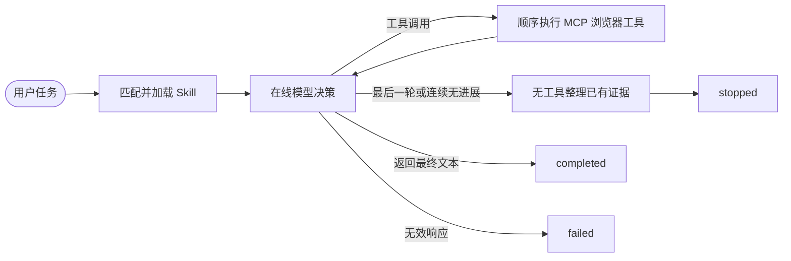

# 浏览器 Agent：LangGraph + Playwright MCP + Skill

用户在 Streamlit 输入任务，LangGraph 选择本地 Skill、调用在线模型决策，并通过 Playwright MCP 操作浏览器。支持 OpenAI-compatible Chat Completions 接口，模型必须支持 tool calling。

## 架构导览

[系统架构与实现说明](docs/architecture.md)。

## 快速启动

需要 Python 3.11+（建议 3.12）、Node.js 18+、pnpm 和 uv。

```bash
uv sync
pnpm install
pnpm run install-browser
cp .env.example .env
```

编辑 `.env`，填写自己的模型服务：

```dotenv
LLM_API_KEY=你的密钥
LLM_BASE_URL=https://api.deepseek.com
LLM_MODEL=deepseek-chat
BROWSER_EXECUTABLE_PATH=
```

Base URL 和模型名称需与所用供应商一致；可以更换为其他支持工具调用的兼容接口。也可以直接在侧栏输入，密钥不保存到项目文件。不要提交 `.env`。

```bash
uv run streamlit run app.py
```

打开终端显示的本地地址（通常为 `http://localhost:8501`）。默认使用无头 Chromium；本机有桌面环境时取消勾选“无头浏览器”，即可观察浏览器操作。

如果已经安装 Chrome/Chromium，可设置 `BROWSER_EXECUTABLE_PATH` 为其完整路径，省略浏览器下载。Linux 若提示系统库缺失，可按照 Playwright 提示安装依赖（例如 `npx playwright install-deps chromium`，可能需要系统管理员权限）。


## 实现结构

```text
app.py                    Streamlit 输入、实时进度、结果与执行记录
browser_agent/
  graph.py                LangGraph 状态、决策循环、顺序工具执行、轮数限制
  runtime.py              模型配置、MCP 会话、任务超时和资源释放
  browser_tools.py        合并导航和正文读取，减少模型往返
  skills.py               SKILL.md 解析和关键词选择
skills/
  search/SKILL.md          网页搜索策略
  forms/SKILL.md           表单填写策略
  extract/SKILL.md         信息提取策略
tests/                    无需在线 API 的测试
scripts/smoke_browser.py   真实 Playwright MCP 本地页面冒烟测试
```



图状态记录任务、消息列表、选中的 Skill、模型轮数、状态和最终回答。`completed` 表示模型结束执行并给出回答，不保证外部网站上的任务成功；是否成功、受阻或需要补充信息，应以回答和工具记录为准。连接、模型请求及其他运行错误在应用边界显示为 `failed`，超时也会结束会话。

浏览器工具从 MCP 动态发现，通过 `load_mcp_tools` 转为模型可调用的工具。一个任务显式持有一个 `ClientSession`，避免导航后下一次工具调用丢失页面状态。即使模型一次返回多个调用，也按顺序执行，以免点击、填写、导航争用同一页面。工具名称或参数错误作为工具消息反馈给模型；底层连接错误终止任务。最大模型轮数包括最后的结果整理：例如设为 15 时，最多 14 轮可调用工具，第 15 轮使用不绑定工具的模型，根据已有证据整理结果、链接和未完成部分，不额外增加调用预算。设为 1 时只有整理轮，不会浏览网页。每轮都会告知模型剩余预算；连续三轮的工具名称、参数和返回文本完全相同时提前整理退出（不同结果不会判为重复）。

资料查询优先使用 `browser_read_page`：内部顺序调用 MCP 导航与正文读取，一次模型决策即可获得页面标题、实际 URL、正文和链接。它不会减少底层浏览器操作次数，但能减少模型往返。读取结果限制正文和链接数量；必要时再按关键词提取遗漏部分。普通浏览器交互工具仍然可用。

## 添加 Skill

创建 `skills/你的策略/SKILL.md`：

```markdown
---
name: compare
description: 对比多个网页上的信息
keywords: [对比, 比较, compare]
---
1. 确定需要比较的字段。
2. 逐个打开页面读取证据，保留来源 URL。
3. 用表格展示相同点和差异，不补造缺失信息。
```

每次任务读取本地文件，按关键词（忽略大小写、子串匹配）加载所有匹配策略，并将正文注入系统提示词；无匹配时使用通用浏览器策略。不这种简单匹配可能漏掉同义表达，添加关键词即可调整。Skill 文件是本地可信策略，不从网页下载或执行任意 Python 代码。

## 测试

无需 API Key 的自动测试：

```bash
uv run pytest -q
uv run ruff check .
```

测试覆盖 Skill 选择和格式错误、真实 LangGraph 的工具循环、工具观察回传、浏览器操作顺序、轮数限制、无效工具及参数、配置校验、MCP stdio 会话状态、连接故障和 Streamlit 初始交互。

安装 Node 依赖和 Chromium 后，运行真实浏览器冒烟测试：

```bash
uv run python scripts/smoke_browser.py
```

该脚本启动本地 HTTP 页面，连接真实 Playwright MCP，依次导航、填写姓名、点击按钮、检查结果并释放资源。它不需要在线模型、API Key 或外部网站。

## 范围与注意事项

网页文本按不可信内容处理；提示词要求不服从网页中改变任务的指令、不编造结果、不擅自提交敏感操作。任务可能包含表单值，执行记录也会显示这些值。

常见问题：

- **找不到 MCP**：先在项目根目录运行 `pnpm install`。
- **找不到浏览器**：运行 `pnpm run install-browser`，或填写浏览器可执行文件路径。
- **模型 401/404**：检查 API Key、Base URL 和模型名称。
- **模型不调用工具或参数无效**：确认接口和模型支持 tool calling。
- **页面需要登录/验证码**：Agent 会说明阻碍。
- **轮数不足或超时**：缩小任务范围，或在侧栏调整上限后重新运行。

实现参考：[LangGraph](https://docs.langchain.com/oss/python/langgraph/overview)、[MCP 适配器会话用法](https://github.com/langchain-ai/langchain-mcp-adapters)、[Playwright MCP 官方说明](https://github.com/microsoft/playwright-mcp)。
