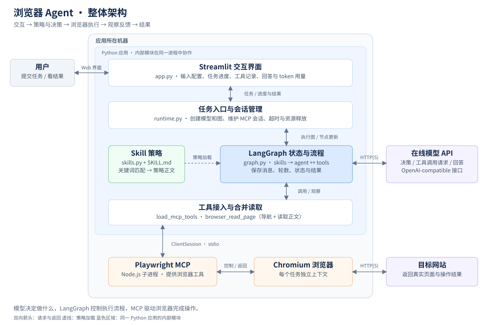
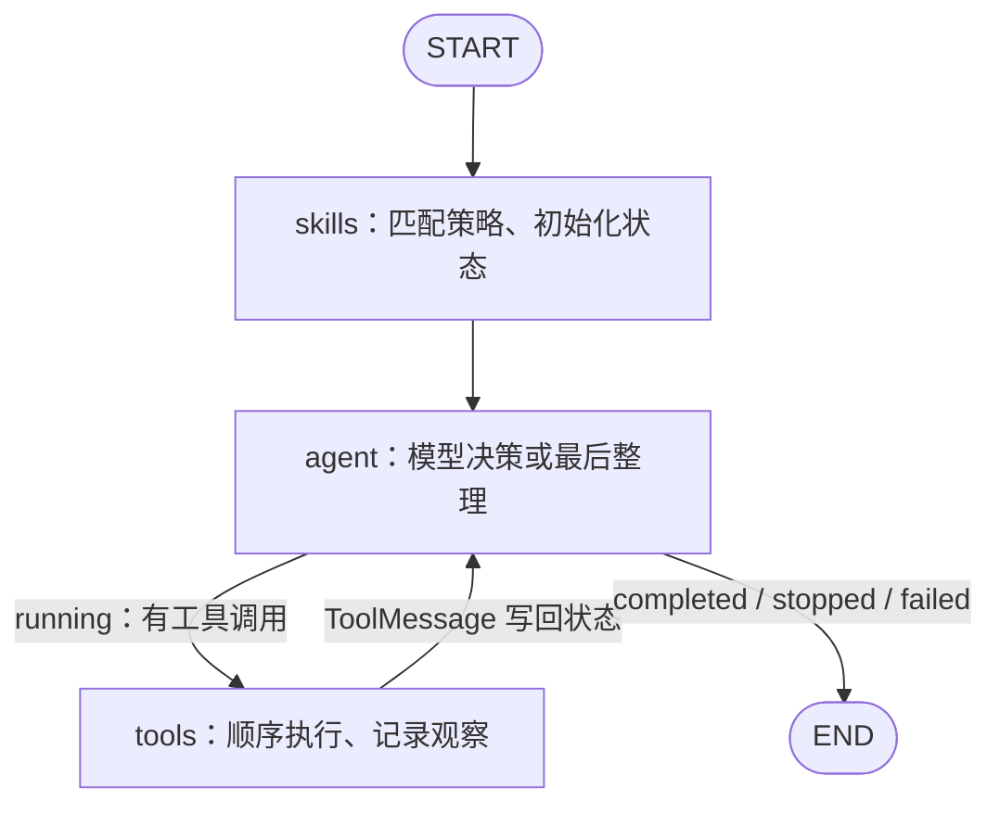
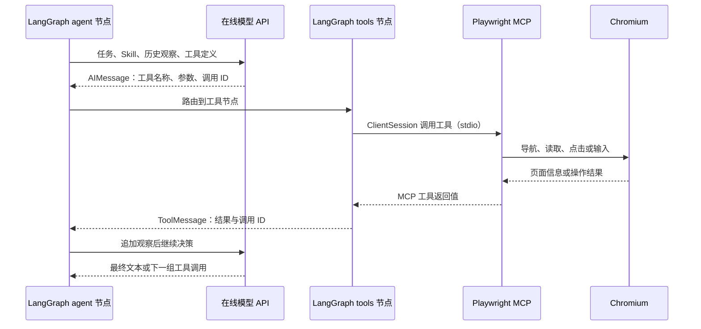

# 浏览器 Agent 架构与实现说明

## 1. 项目做什么

用户用自然语言描述浏览器任务，系统加载适用的操作策略，让在线大模型选择浏览器工具，再根据工具返回的真实页面信息继续执行，最终给出结果和来源。

**一句话概括：Streamlit 负责交互，LangGraph 负责流程与状态，大模型负责决策，Playwright MCP 负责操作浏览器，Skill 负责提供任务策略。**

本项目采用一个 Python 应用、一个任务级 MCP 子进程和一个独立浏览器上下文。核心流程不依赖数据库、向量检索或多 Agent 协作。

## 2. 整体架构图



[下载 SVG 矢量图](architecture.svg) · [下载 PNG 图片](architecture.png) · [查看 Mermaid 源码](architecture.mmd)

| 组成部分 | 回答的问题 | 当前实现 |
| --- | --- | --- |
| Streamlit | 用户如何提交任务、查看过程？ | 输入任务与配置，展示进度、工具记录、回答和 token 用量 |
| 任务运行入口 | 一个任务如何启动和结束？ | 校验配置，连接 MCP，创建模型和状态图，控制超时，释放会话 |
| LangGraph | 下一步执行哪个节点，保存什么状态？ | `skills → agent → tools → agent` 循环，以及条件结束 |
| 在线大模型 | 当前页面下应该做什么？ | 接收消息、策略和工具定义，返回工具调用或最终文本 |
| Skill 系统 | 这类任务应遵循什么操作步骤？ | 本地 Markdown 文件，按关键词选择，将策略正文加入系统提示词 |
| MCP 工具接入 | Python 如何调用浏览器能力？ | 通过 stdio 连接 Playwright MCP，动态加载工具定义和调用接口 |
| Playwright / Chromium | 网页操作实际由谁执行？ | 导航、读取、点击、输入等操作，返回页面信息 |

**模型不直接操作浏览器。** 模型返回的是工具名称和参数；Python 的工具节点负责执行，MCP 服务驱动浏览器。执行结果再作为消息送回模型，形成反馈循环。

## 3. 一次任务如何执行

以“搜索 LangGraph 官方文档，整理状态图和工具调用的相关页面并给出链接”为例：

1. **提交任务。** `app.py` 收集任务、模型地址、API Key、最大轮数和超时时间，创建 `Settings` 并调用 `run_task()`。
2. **建立执行环境。** `runtime.py` 启动 Playwright MCP 子进程、初始化 `ClientSession`，通过 `load_mcp_tools()` 获取工具；再加入项目提供的合并读取工具。
3. **加载策略。** `skills` 节点根据任务中的“搜索”“整理”等关键词选择 `search`、`extract`，将操作策略加入系统消息，同时初始化任务状态。
4. **模型决策。** `agent` 节点发送用户任务、策略、已有工具结果和本轮预算。模型选择读取页面、点击等工具，或直接给出答案。
5. **执行浏览器操作。** `tools` 节点按顺序执行模型请求。例如 `browser_read_page` 内部先导航，再提取页面标题、正文和链接。
6. **观察与继续。** 工具返回值被封装为 `ToolMessage` 写入状态，重新进入 `agent` 节点。模型以新证据判断是否已覆盖用户要求。
7. **结束和展示。** 得到回答、进入预算整理或发生运行错误时退出。节点更新经回调传到 Streamlit；任务结束后关闭会话和子进程。

### 实际 LangGraph 节点



### 模型与浏览器之间的数据流



## 4. LangGraph 保存什么状态

`AgentState` 是任务状态的结构定义，消息列表使用 `add_messages` 合并各节点产生的新消息。

| 字段 | 用途 |
| --- | --- |
| `task` | 原始用户任务 |
| `messages` | 系统消息、用户任务、模型响应和工具观察 |
| `selected_skills` | 本任务实际加载的 Skill 名称 |
| `steps` / `max_steps` | 已执行的模型轮数和总轮数预算 |
| `status` / `answer` | 当前状态及最终回答 |
| `stop_reason` | 预算整理或无进展停止的原因 |
| `last_observation` / `repeated_rounds` | 对比连续操作及返回文本，识别完全重复的执行 |
| `input_tokens` / `output_tokens` | 累计模型接口报告的 token 用量 |

| 状态 | 触发条件 | 页面上应该如何理解 |
| --- | --- | --- |
| `running` | 任务正在决策或执行工具 | 执行中 |
| `completed` | 模型主动返回非空最终文本 | 模型结束执行；仍需看回答是否说明受阻或未完成 |
| `stopped` | 保留的最后一轮，或连续三轮操作与结果相同 | 停止探索，展示基于现有证据整理的结果 |
| `failed` | 无效模型响应、连接错误、超时等 | 执行失败，显示原因和已有记录 |

状态保存在当前任务和 Streamlit 会话内，没有使用持久化 checkpoint。再次提交任务会创建新图和新浏览器上下文。

## 5. Skill 如何影响行为

Skill 是**可编辑的操作策略文本**。模型工具提供“能做什么”，Skill 提供“这一类任务应该怎样做”。

```text
用户任务
  ↓ 忽略大小写的关键词子串匹配
选中一个或多个 SKILL.md
  ↓ 读取 Markdown 正文
系统提示词 = 通用浏览器规则 + 选中的策略
  ↓
影响模型的工具选择、执行顺序和结束判断
```

| Skill | 示例关键词 | 策略重点 |
| --- | --- | --- |
| `search` | 搜索、查询、search | 少量可靠页面覆盖主题后结束，避免全站遍历 |
| `forms` | 表单、填写、fill | 按字段填写用户提供的信息，检查校验提示 |
| `extract` | 提取、整理、价格 | 保留原始字段、单位和来源，整理为表格或清单 |

一个文件包含 YAML 元数据 `name`、`description`、`keywords`，其后是 Markdown 操作步骤。新增 Skill 只需在 `skills/` 下新增对应目录和 `SKILL.md`；下一次任务会重新读取。未匹配到策略时，仍使用通用浏览器规则。

当前选择方法是确定性关键词匹配，不涉及模型训练、向量数据库或额外模型调用。策略通过提示词约束行为，不是强制权限机制。

## 6. 关键设计与优化

### 同一任务复用 MCP 会话

`connect_tools()` 在整个图执行期间保持一个 `ClientSession`，让导航、读取和点击共享页面状态。所有浏览器调用按顺序执行，避免同一页面被并发操作。上下文管理器负责退出时关闭资源。

### 合并打开与读取，减少模型往返

```text
普通读取：模型 → 导航 → 模型 → 读取正文 → 模型
合并读取：模型 → browser_read_page〔导航 → 读取正文〕→ 模型
```

`browser_read_page` 是项目在 Python 侧封装的工具，不是新增 MCP 服务。它调用已有的 `browser_navigate` 和 `browser_evaluate`，优先读取 `article`，其次 `main`，最后使用 `body`，返回标题、实际 URL、正文与链接。正文上限 10,000 字符，链接最多 30 个，并返回是否截断。交互任务仍可使用原始 MCP 工具。

### 在预算内给出当前结果

默认最多 15 轮，其中最后一轮只做证据整理，不向模型绑定工具。若此前已完成，模型可以更早回答；若连续三轮的工具名称、参数和返回文本完全相同，则提前进入整理。它能识别完全重复的尝试，不能判断所有语义上的兜圈。

### 控制输入体积并保留观察依据

MCP 使用 `--codegen none` 避免重复回显执行代码。送入模型的单条工具文本超过 12,000 字符时，保留开头 9,000 字符和结尾 3,000 字符，添加截断提示；任务中的原始工具记录不变。这是按消息限长，不是整段对话的 token 硬上限。
